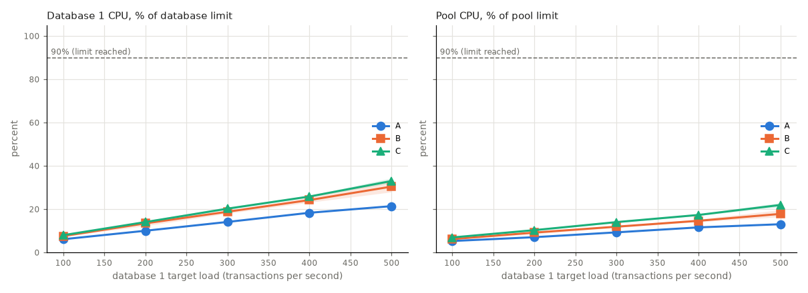
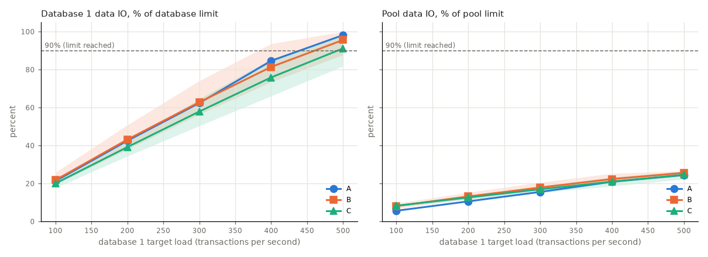
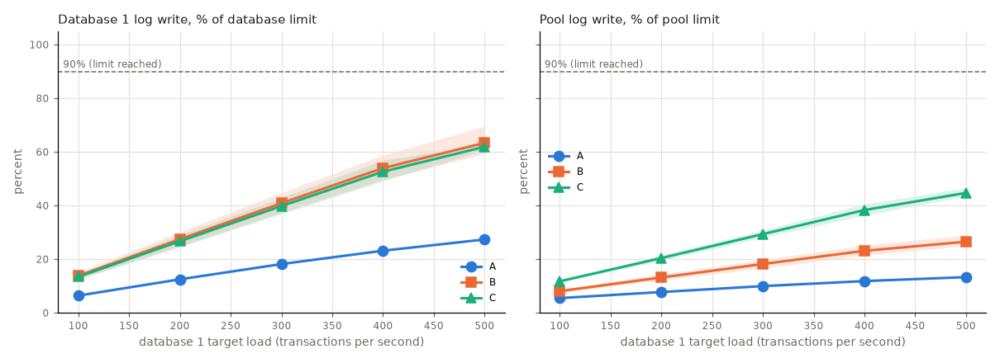
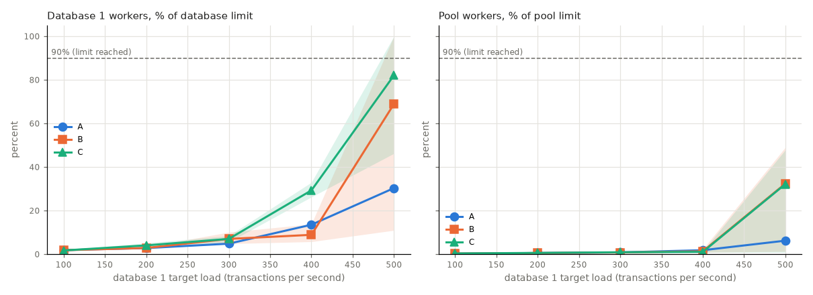
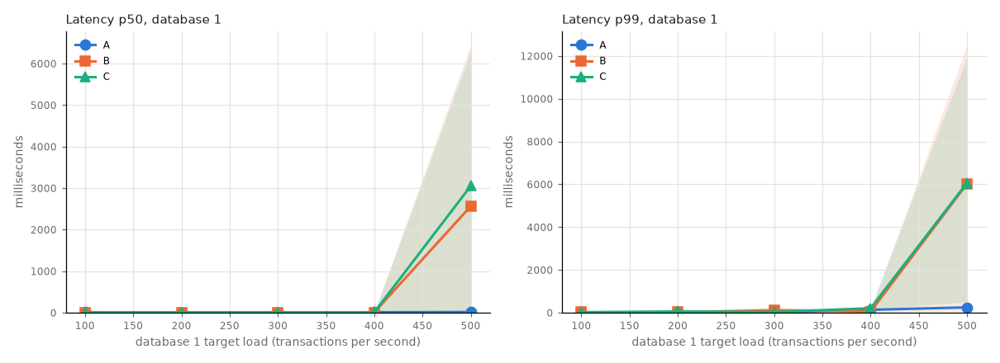
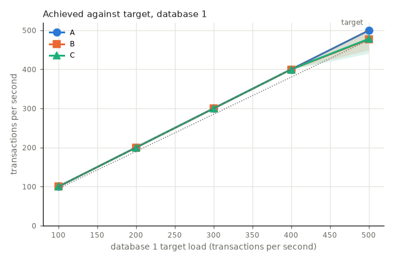
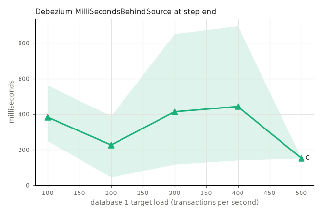
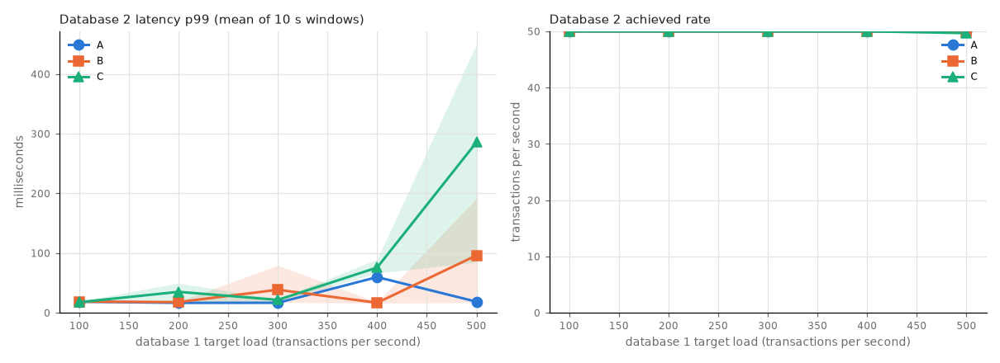
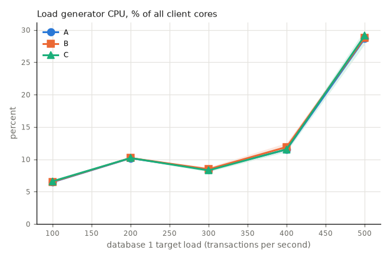

# CDC impact on an Azure SQL elastic pool: report

New to this? Read the plain-language summary first: [SUMMARY.md](SUMMARY.md). This file is the technical appendix behind it.

Runs: 45062722769-1. Generated from the raw result files of each run by `python -m report`.

Figures are labelled **measured** (read from the run's raw files), **derived** (arithmetic on measured figures) or **EXTRAPOLATION** (a model beyond what was measured). Configurations: A no outbox, B outbox only, C outbox with change data capture (CDC) and Debezium reading it. CDC is SQL's built-in change log; Debezium is the reader that publishes those changes onward.

## Answer: which limit is reached first

Run 45062722769-1 (mode quick, 4 vCore pool, per-database cap 2 vCores; measured):

- Configuration A: **database 1 data IO** reached between 400 and 500 tps: 98.1% of limit at 500 tps, confirmed by wait types, load still carried.
- Configuration B: **database 1 data IO** reached between 300 and 400 tps: 93.6% of limit at 400 tps, confirmed by wait types, load still carried.
- Configuration C: **database 1 workers** reached between 400 and 500 tps: 100.0% of limit at 500 tps, no wait confirmation available, load not carried.

## Runs (measured)

| Run | Mode | Status | Pool vCores | DB cap vCores | Configurations | Steps (tps) | Warm-up / measured (s) | Repeats | Database 2 load | Payload | Started (UTC) | Finished (UTC) |
| --- | --- | --- | --- | --- | --- | --- | --- | --- | --- | --- | --- | --- |
| 45062722769-1 | quick | succeeded | 4 | 2 | A, B, C | 100, 200, 300, 400, 500 | 60 / 120 | 3 | 50 tps B | 4096 chars nvarchar(max) | 2026-11-22T19:56:13.423805+00:00 | 2026-11-22T23:38:35.954753+00:00 |

Pool vCores: the documented General Purpose standard-series size whose pool log rate and pool IOPS limits both equal the limits the run recorded from `sys.dm_user_db_resource_governance`.

## Per step: load carried and the binding limit (measured)

A step carries its load when achieved rate is at least 95% of target and errors plus shed are 0. The binding limit is the resource with the highest mean percent of its limit over the resource-stats rows that lie wholly inside the measured window, among CPU, data IO, log write, workers and sessions at database 1 and pool level. Below 90% the step says "none reached". Wait-type deltas over the window confirm it: `SOS_SCHEDULER_YIELD` for CPU, `PAGEIOLATCH_*` for data IO, `LOG_RATE_GOVERNOR` (database) or `POOL_LOG_RATE_GOVERNOR` and `INSTANCE_LOG_RATE_GOVERNOR` (pool) for log write, `THREADPOOL` for workers.

Run 45062722769-1:

| Config | Repeat | Target tps | Window (s) | Achieved tps | % of target | Errors | Shed | Carries | Binding limit | Highest % of limit | Wait evidence |
| --- | --- | --- | --- | --- | --- | --- | --- | --- | --- | --- | --- |
| A | 1 | 100 | 120 | 100.0 | 100.0 | 0 | 0 | yes | none reached | 21.3 | highest database 1 data IO 21.3%; no governor waits |
| A | 1 | 200 | 120 | 200.0 | 100.0 | 0 | 0 | yes | none reached | 42.5 | highest database 1 data IO 42.5%; no governor waits |
| A | 1 | 300 | 120 | 300.0 | 100.0 | 0 | 0 | yes | none reached | 62.3 | highest database 1 data IO 62.3%; no governor waits |
| A | 1 | 400 | 120 | 399.9 | 100.0 | 0 | 0 | yes | none reached | 84.6 | highest database 1 data IO 84.6%; no governor waits |
| A | 1 | 500 | 120 | 499.4 | 99.9 | 0 | 0 | yes | database 1 data IO | 98.1 | confirmed by PAGEIOLATCH_SH 15.5 ms/s, PAGEIOLATCH_EX 20269.2 ms/s; no governor waits |
| B | 1 | 100 | 120 | 100.0 | 100.0 | 0 | 0 | yes | none reached | 20.0 | highest database 1 data IO 20.0%; no governor waits |
| B | 1 | 200 | 120 | 200.0 | 100.0 | 0 | 0 | yes | none reached | 40.6 | highest database 1 data IO 40.6%; no governor waits |
| B | 1 | 300 | 120 | 300.0 | 100.0 | 0 | 0 | yes | none reached | 57.9 | highest database 1 data IO 57.9%; no governor waits |
| B | 1 | 400 | 120 | 400.0 | 100.0 | 0 | 0 | yes | none reached | 77.0 | highest database 1 data IO 77.0%; no governor waits |
| B | 1 | 500 | 125 | 479.5 | 95.9 | 13 | 0 | **no** | database 1 data IO | 100.0 | confirmed by PAGEIOLATCH_SH 380.5 ms/s, PAGEIOLATCH_EX 147851.1 ms/s; db LOG_RATE_GOVERNOR 48.3 ms/s, pool LOG_RATE_GOVERNOR 58.5 ms/s |
| C | 1 | 100 | 120 | 100.0 | 100.0 | 0 | 0 | yes | none reached | 21.3 | highest database 1 data IO 21.3%; no governor waits |
| C | 1 | 200 | 120 | 200.0 | 100.0 | 0 | 0 | yes | none reached | 42.1 | highest database 1 data IO 42.1%; no governor waits |
| C | 1 | 300 | 120 | 300.0 | 100.0 | 0 | 0 | yes | none reached | 64.5 | highest database 1 data IO 64.5%; db POOL_LOG_RATE_GOVERNOR 15.4 ms/s, pool LOG_RATE_GOVERNOR 3.2 ms/s, pool POOL_LOG_RATE_GOVERNOR 18.7 ms/s |
| C | 1 | 400 | 120 | 399.9 | 100.0 | 0 | 0 | yes | none reached | 85.6 | highest database 1 data IO 85.6%; db POOL_LOG_RATE_GOVERNOR 972.7 ms/s, pool LOG_RATE_GOVERNOR 2.6 ms/s, pool POOL_LOG_RATE_GOVERNOR 1190.7 ms/s |
| C | 1 | 500 | 131 | 440.8 | 88.2 | 35 | 2,078 | **no** | database 1 workers | 100.0 | wait deltas unavailable; db POOL_LOG_RATE_GOVERNOR 1338.9 ms/s, pool LOG_RATE_GOVERNOR 1.3 ms/s, pool POOL_LOG_RATE_GOVERNOR 1610.7 ms/s |
| B | 2 | 100 | 120 | 100.0 | 100.0 | 0 | 0 | yes | none reached | 25.8 | highest database 1 data IO 25.8%; no governor waits |
| B | 2 | 200 | 120 | 200.0 | 100.0 | 0 | 0 | yes | none reached | 50.8 | highest database 1 data IO 50.8%; no governor waits |
| B | 2 | 300 | 120 | 300.0 | 100.0 | 0 | 0 | yes | none reached | 74.0 | highest database 1 data IO 74.0%; no governor waits |
| B | 2 | 400 | 120 | 399.9 | 100.0 | 0 | 0 | yes | database 1 data IO | 93.6 | confirmed by PAGEIOLATCH_SH 2.2 ms/s, PAGEIOLATCH_EX 23947.8 ms/s; no governor waits |
| B | 2 | 500 | 131 | 449.4 | 89.9 | 21 | 1,147 | **no** | database 1 workers | 100.0 | wait deltas unavailable; no governor waits |
| C | 2 | 100 | 120 | 100.0 | 100.0 | 0 | 0 | yes | none reached | 21.0 | highest database 1 data IO 21.0%; no governor waits |
| C | 2 | 200 | 120 | 200.0 | 100.0 | 0 | 0 | yes | none reached | 40.9 | highest database 1 data IO 40.9%; no governor waits |
| C | 2 | 300 | 120 | 300.0 | 100.0 | 0 | 0 | yes | none reached | 58.8 | highest database 1 data IO 58.8%; db POOL_LOG_RATE_GOVERNOR 52.6 ms/s, pool LOG_RATE_GOVERNOR 2.4 ms/s, pool POOL_LOG_RATE_GOVERNOR 62.6 ms/s |
| C | 2 | 400 | 120 | 400.0 | 100.0 | 0 | 0 | yes | none reached | 75.9 | highest database 1 data IO 75.9%; db POOL_LOG_RATE_GOVERNOR 692.9 ms/s, pool LOG_RATE_GOVERNOR 5.9 ms/s, pool POOL_LOG_RATE_GOVERNOR 804.6 ms/s |
| C | 2 | 500 | 122 | 492.8 | 98.6 | 42 | 0 | **no** | database 1 workers | 100.0 | wait deltas unavailable; db POOL_LOG_RATE_GOVERNOR 1597.3 ms/s, pool POOL_LOG_RATE_GOVERNOR 1822.8 ms/s |
| B | 3 | 100 | 120 | 100.0 | 100.0 | 0 | 0 | yes | none reached | 19.6 | highest database 1 data IO 19.6%; no governor waits |
| B | 3 | 200 | 120 | 200.0 | 100.0 | 0 | 0 | yes | none reached | 38.0 | highest database 1 data IO 38.0%; no governor waits |
| B | 3 | 300 | 120 | 299.9 | 100.0 | 0 | 0 | yes | none reached | 56.4 | highest database 1 data IO 56.4%; no governor waits |
| B | 3 | 400 | 120 | 400.0 | 100.0 | 0 | 0 | yes | none reached | 73.5 | highest database 1 data IO 73.5%; no governor waits |
| B | 3 | 500 | 120 | 499.9 | 100.0 | 0 | 0 | yes | none reached | 87.8 | highest database 1 data IO 87.8%; no governor waits |
| C | 3 | 100 | 120 | 100.0 | 100.0 | 0 | 0 | yes | none reached | 17.7 | highest database 1 data IO 17.7%; no governor waits |
| C | 3 | 200 | 120 | 200.0 | 100.0 | 0 | 0 | yes | none reached | 34.4 | highest database 1 data IO 34.4%; no governor waits |
| C | 3 | 300 | 120 | 300.0 | 100.0 | 0 | 0 | yes | none reached | 50.3 | highest database 1 data IO 50.3%; db POOL_LOG_RATE_GOVERNOR 14.1 ms/s, pool LOG_RATE_GOVERNOR 1.4 ms/s, pool POOL_LOG_RATE_GOVERNOR 16.9 ms/s |
| C | 3 | 400 | 120 | 400.0 | 100.0 | 0 | 0 | yes | none reached | 66.1 | highest database 1 data IO 66.1%; db POOL_LOG_RATE_GOVERNOR 597.5 ms/s, pool LOG_RATE_GOVERNOR 2.7 ms/s, pool POOL_LOG_RATE_GOVERNOR 697.2 ms/s |
| C | 3 | 500 | 120 | 499.9 | 100.0 | 0 | 0 | yes | none reached | 81.8 | highest database 1 data IO 81.8%; db POOL_LOG_RATE_GOVERNOR 1491.8 ms/s, pool LOG_RATE_GOVERNOR 3.3 ms/s, pool POOL_LOG_RATE_GOVERNOR 1686.6 ms/s |

| Config | Repeat | Target tps | DB1 CPU % | DB1 data IO % | DB1 log write % | DB1 workers % | Pool CPU % | Pool data IO % | Pool log write % | Pool workers % | Rows in window (DB1 / pool) | p50 ms | p95 ms | p99 ms | Debezium ms behind source |
| --- | --- | --- | --- | --- | --- | --- | --- | --- | --- | --- | --- | --- | --- | --- | --- |
| A | 1 | 100 | 6.1 | 21.3 | 6.4 | 1.9 | 5.3 | 5.6 | 5.4 | 0.2 | 7 / 4 | 11.63 | 17.34 | 24.66 | - |
| A | 1 | 200 | 10.0 | 42.5 | 12.5 | 2.8 | 7.0 | 10.6 | 7.7 | 0.5 | 7 / 5 | 8.97 | 17.51 | 23.89 | - |
| A | 1 | 300 | 14.1 | 62.3 | 18.2 | 4.8 | 9.3 | 15.5 | 9.9 | 0.8 | 8 / 5 | 8.80 | 22.24 | 31.48 | - |
| A | 1 | 400 | 18.3 | 84.6 | 23.1 | 13.5 | 11.6 | 20.9 | 11.8 | 1.8 | 8 / 5 | 11.72 | 44.33 | 137.31 | - |
| A | 1 | 500 | 21.4 | 98.1 | 27.3 | 30.3 | 13.0 | 24.4 | 13.3 | 6.2 | 8 / 5 | 17.26 | 169.62 | 250.11 | - |
| B | 1 | 100 | 7.7 | 20.0 | 15.2 | 2.1 | 6.1 | 6.6 | 8.7 | 0.4 | 8 / 6 | 10.88 | 20.34 | 27.65 | - |
| B | 1 | 200 | 14.4 | 40.6 | 30.3 | 3.2 | 9.7 | 11.9 | 14.4 | 0.5 | 7 / 4 | 9.19 | 16.76 | 23.91 | - |
| B | 1 | 300 | 19.1 | 57.9 | 44.8 | 6.1 | 12.1 | 16.5 | 19.8 | 0.8 | 7 / 5 | 9.06 | 20.34 | 29.55 | - |
| B | 1 | 400 | 24.0 | 77.0 | 58.8 | 7.1 | 14.4 | 21.2 | 25.2 | 0.9 | 7 / 5 | 8.83 | 25.15 | 37.26 | - |
| B | 1 | 500 | 33.5 | 100.0 | 69.6 | 95.9 | 19.7 | 26.6 | 29.0 | 46.9 | 7 / 5 | 1,223.05 | 4,846.86 | 5,503.38 | - |
| C | 1 | 100 | 8.1 | 21.3 | 14.6 | 1.9 | 7.0 | 8.5 | 12.1 | 0.4 | 7 / 5 | 7.80 | 14.62 | 20.01 | 337 |
| C | 1 | 200 | 14.6 | 42.1 | 29.0 | 5.1 | 10.8 | 13.3 | 21.5 | 0.5 | 7 / 5 | 10.06 | 23.95 | 113.64 | 245 |
| C | 1 | 300 | 21.0 | 64.5 | 43.0 | 7.1 | 14.5 | 18.6 | 30.8 | 1.0 | 7 / 5 | 10.94 | 23.03 | 32.38 | 118 |
| C | 1 | 400 | 26.3 | 85.6 | 56.9 | 32.9 | 17.7 | 23.3 | 40.5 | 1.3 | 7 / 4 | 13.48 | 43.92 | 165.41 | 896 |
| C | 1 | 500 | 32.5 | 98.4 | 62.2 | 100.0 | 21.8 | 26.4 | 43.4 | 47.9 | 8 / 6 | 6,287.90 | 11,707.60 | 11,928.21 | n/a |
| B | 2 | 100 | 7.7 | 25.8 | 13.6 | 1.6 | 6.2 | 9.6 | 7.9 | 0.2 | 7 / 5 | 9.52 | 14.75 | 20.55 | - |
| B | 2 | 200 | 13.6 | 50.8 | 27.1 | 2.8 | 9.2 | 15.3 | 13.0 | 0.7 | 7 / 5 | 9.38 | 16.91 | 23.98 | - |
| B | 2 | 300 | 19.3 | 74.0 | 40.5 | 4.8 | 12.1 | 20.6 | 18.1 | 0.8 | 7 / 5 | 9.94 | 23.09 | 33.15 | - |
| B | 2 | 400 | 25.5 | 93.6 | 53.4 | 13.8 | 15.3 | 25.2 | 22.7 | 2.2 | 8 / 5 | 14.86 | 59.00 | 100.07 | - |
| B | 2 | 500 | 29.9 | 98.9 | 59.3 | 100.0 | 17.3 | 26.3 | 25.0 | 49.0 | 7 / 6 | 6,457.75 | 11,913.48 | 12,533.52 | - |
| C | 2 | 100 | 7.7 | 21.0 | 13.2 | 1.7 | 6.8 | 8.5 | 11.7 | 0.3 | 7 / 5 | 7.30 | 13.73 | 18.31 | 249 |
| C | 2 | 200 | 13.8 | 40.9 | 26.5 | 2.9 | 10.1 | 13.0 | 20.4 | 0.6 | 7 / 5 | 7.95 | 16.18 | 22.20 | 45 |
| C | 2 | 300 | 19.9 | 58.8 | 39.5 | 8.4 | 13.7 | 17.1 | 29.1 | 0.9 | 7 / 5 | 9.06 | 20.84 | 35.86 | 852 |
| C | 2 | 400 | 25.5 | 75.9 | 51.9 | 26.2 | 17.1 | 21.0 | 38.0 | 0.9 | 7 / 5 | 8.09 | 29.66 | 261.07 | 292 |
| C | 2 | 500 | 34.4 | 93.2 | 62.8 | 100.0 | 23.0 | 25.1 | 46.5 | 47.8 | 7 / 4 | 2,858.14 | 5,209.42 | 5,791.01 | n/a |
| B | 3 | 100 | 7.3 | 19.6 | 12.6 | 1.7 | 6.2 | 8.0 | 7.5 | 0.3 | 7 / 5 | 7.34 | 14.65 | 20.22 | - |
| B | 3 | 200 | 12.3 | 38.0 | 24.8 | 2.5 | 8.5 | 12.3 | 12.1 | 0.3 | 8 / 5 | 7.27 | 14.02 | 18.72 | - |
| B | 3 | 300 | 18.0 | 56.4 | 37.3 | 10.1 | 11.5 | 16.6 | 16.6 | 0.7 | 8 / 5 | 7.88 | 25.62 | 280.54 | - |
| B | 3 | 400 | 23.1 | 73.5 | 49.7 | 5.7 | 14.1 | 20.5 | 21.4 | 0.9 | 7 / 5 | 7.94 | 20.41 | 30.48 | - |
| B | 3 | 500 | 27.9 | 87.8 | 61.2 | 10.9 | 16.4 | 23.9 | 25.5 | 1.2 | 7 / 4 | 9.49 | 29.82 | 46.83 | - |
| C | 3 | 100 | 8.0 | 17.7 | 12.4 | 1.5 | 7.0 | 7.8 | 11.3 | 0.2 | 7 / 5 | 7.01 | 13.67 | 18.15 | 562 |
| C | 3 | 200 | 13.7 | 34.4 | 24.5 | 4.0 | 10.0 | 11.5 | 19.4 | 0.6 | 7 / 5 | 7.38 | 18.72 | 45.67 | 390 |
| C | 3 | 300 | 19.8 | 50.3 | 36.9 | 5.5 | 13.8 | 15.1 | 28.0 | 0.8 | 7 / 5 | 7.99 | 17.00 | 24.26 | 270 |
| C | 3 | 400 | 25.8 | 66.1 | 49.0 | 28.6 | 17.2 | 18.6 | 36.3 | 1.0 | 7 / 6 | 7.73 | 29.43 | 205.81 | 141 |
| C | 3 | 500 | 32.1 | 81.8 | 60.6 | 46.2 | 21.0 | 22.2 | 44.0 | 0.9 | 7 / 5 | 7.93 | 104.48 | 502.05 | 152 |

Absolute IO for database 1 (derived: deltas of cumulative counters over the polls that bracket the window). Governed log rate is database 1's `avg_log_write_percent` times its recorded log rate limit.

| Config | Repeat | Target tps | Log written (MiB/s) | Log bytes flushed counter (MiB/s) | Governed log rate (MiB/s) | Log bytes per transaction | Data bytes written per transaction | Data IOPS | Counter interval (s) |
| --- | --- | --- | --- | --- | --- | --- | --- | --- | --- |
| A | 1 | 100 | 0.89 | 0.84 | 0.57 | 9,384 | 45,407 | 380 | 137 |
| A | 1 | 200 | 1.69 | 1.69 | 1.12 | 8,842 | 44,863 | 738 | 137 |
| A | 1 | 300 | 2.43 | 2.43 | 1.63 | 8,496 | 42,697 | 1,073 | 137 |
| A | 1 | 400 | 2.99 | 2.99 | 2.08 | 7,834 | 39,448 | 1,394 | 127 |
| A | 1 | 500 | 3.38 | 3.38 | 2.46 | 7,107 | 38,395 | 1,631 | 127 |
| B | 1 | 100 | 1.61 | 1.61 | 1.37 | 16,889 | 50,816 | 382 | 126 |
| B | 1 | 200 | 3.34 | 3.34 | 2.72 | 17,538 | 51,215 | 801 | 137 |
| B | 1 | 300 | 4.86 | 4.86 | 4.03 | 16,978 | 49,593 | 1,143 | 137 |
| B | 1 | 400 | 6.35 | 6.35 | 5.29 | 16,644 | 44,017 | 1,386 | 137 |
| B | 1 | 500 | 7.39 | 7.40 | 6.26 | 16,167 | 43,896 | 1,628 | 137 |
| C | 1 | 100 | 2.54 | 2.54 | 1.31 | 26,599 | 57,267 | 437 | 126 |
| C | 1 | 200 | 5.11 | 5.11 | 2.61 | 26,808 | 58,260 | 876 | 137 |
| C | 1 | 300 | 7.54 | 7.54 | 3.87 | 26,355 | 56,313 | 1,262 | 137 |
| C | 1 | 400 | 9.92 | 10.00 | 5.12 | 26,007 | 51,159 | 1,491 | 137 |
| C | 1 | 500 | 10.53 | 10.41 | 5.60 | 25,051 | 51,931 | 1,674 | 200 |
| B | 2 | 100 | 1.57 | 1.57 | 1.22 | 16,460 | 46,213 | 436 | 137 |
| B | 2 | 200 | 3.02 | 3.02 | 2.44 | 15,853 | 45,779 | 864 | 137 |
| B | 2 | 300 | 4.40 | 4.40 | 3.64 | 15,394 | 42,234 | 1,205 | 127 |
| B | 2 | 400 | 5.78 | 5.73 | 4.80 | 15,153 | 42,124 | 1,582 | 140 |
| B | 2 | 500 | 6.04 | 6.04 | 5.34 | 14,092 | 41,258 | 1,703 | 147 |
| C | 2 | 100 | 2.43 | 2.43 | 1.19 | 25,481 | 52,852 | 429 | 126 |
| C | 2 | 200 | 4.83 | 4.83 | 2.38 | 25,313 | 54,462 | 872 | 127 |
| C | 2 | 300 | 7.23 | 7.22 | 3.56 | 25,256 | 51,569 | 1,240 | 137 |
| C | 2 | 400 | 9.71 | 9.70 | 4.67 | 25,458 | 48,481 | 1,494 | 137 |
| C | 2 | 500 | 11.32 | 11.32 | 5.65 | 24,093 | 44,537 | 1,722 | 127 |
| B | 3 | 100 | 1.46 | 1.46 | 1.13 | 15,287 | 42,872 | 396 | 137 |
| B | 3 | 200 | 2.82 | 2.82 | 2.24 | 14,765 | 39,112 | 726 | 126 |
| B | 3 | 300 | 4.11 | 4.11 | 3.36 | 14,371 | 39,299 | 1,115 | 127 |
| B | 3 | 400 | 5.40 | 5.40 | 4.47 | 14,162 | 37,252 | 1,427 | 127 |
| B | 3 | 500 | 6.56 | 6.56 | 5.51 | 13,766 | 34,301 | 1,610 | 127 |
| C | 3 | 100 | 2.47 | 2.47 | 1.12 | 25,924 | 52,351 | 424 | 127 |
| C | 3 | 200 | 4.74 | 4.74 | 2.21 | 24,862 | 50,562 | 818 | 127 |
| C | 3 | 300 | 6.79 | 6.79 | 3.32 | 23,742 | 47,824 | 1,151 | 127 |
| C | 3 | 400 | 9.30 | 9.30 | 4.41 | 24,381 | 45,799 | 1,456 | 137 |
| C | 3 | 500 | 11.54 | 11.54 | 5.46 | 24,206 | 42,433 | 1,562 | 127 (partial) |

## Charts (measured)

*CPU, database 1 and pool (measured).*

*data IO, database 1 and pool (measured).*

*log write, database 1 and pool (measured).*

*workers, database 1 and pool (measured).*

*Latency, database 1 (measured).*

*Achieved against target; dotted line is 95% of target (measured).*

*Debezium lag, configuration C, one reading at the end of each step (measured).*

*Neighbour impact: database 2 against database 1 load (measured).*

*Client-side proof: load generator CPU (measured).*

## Uplift (derived)

C - B is CDC alone, B - A the outbox alone, C - A both. Only steps where both configurations carried their load in every repeat. Jitter is the spread across repeats when there are several; with one repeat it is the standard deviation of the samples inside the window (15 s resource rows, or the poll intervals of the cumulative counters). When the difference is not larger than the jitter, no uplift figure is given.

Run 45062722769-1:

Pairs with A use only the repeats in which A ran (the quick run runs A in repeat 1 only, decision 0018), so their jitter is the within-window spread of one repeat. C - B uses every repeat.

| Pair | Step (tps) | Metric | First | Second | Difference | Difference % | Jitter | Repeats used | Note |
| --- | --- | --- | --- | --- | --- | --- | --- | --- | --- |
| C - B | 100 | log bytes per transaction (database 1 log file) (bytes) | 26,001 | 16,212 | 9,789 | 60.4 % | 1,601 | 3 |  |
| C - B | 100 | data bytes written per transaction (database 1 data files) (bytes) | 54,157 | 46,634 | - | - | 7,944 | 3 | difference within jitter |
| C - B | 100 | data IOPS per 100 tps (database 1 data files) (IOPS) | 430.04 | 404.40 | - | - | 54.20 | 3 | difference within jitter |
| C - B | 100 | database 1 CPU % per 100 tps (% of database limit) | 7.97 | 7.56 | 0.42 | 5.6 % | 0.40 | 3 |  |
| C - B | 100 | pool CPU % per 100 tps (% of pool limit) | 6.91 | 6.15 | 0.76 | 12.4 % | 0.21 | 3 |  |
| C - B | 100 | database 1 data IO % (% of database limit) | 20.00 | 21.78 | - | - | 6.27 | 3 | difference within jitter |
| C - B | 100 | database 1 log write % (% of database limit) | 13.41 | 13.80 | - | - | 2.65 | 3 | difference within jitter |
| C - B | 200 | log bytes per transaction (database 1 log file) (bytes) | 25,661 | 16,052 | 9,609 | 59.9 % | 2,773 | 3 |  |
| C - B | 200 | data bytes written per transaction (database 1 data files) (bytes) | 54,428 | 45,369 | - | - | 12,104 | 3 | difference within jitter |
| C - B | 200 | data IOPS per 100 tps (database 1 data files) (IOPS) | 427.78 | 398.59 | - | - | 68.98 | 3 | difference within jitter |
| C - B | 200 | database 1 CPU % per 100 tps (% of database limit) | 7.01 | 6.71 | - | - | 1.06 | 3 | difference within jitter |
| C - B | 200 | pool CPU % per 100 tps (% of pool limit) | 5.15 | 4.58 | - | - | 0.60 | 3 | difference within jitter |
| C - B | 200 | database 1 data IO % (% of database limit) | 39.14 | 43.12 | - | - | 12.78 | 3 | difference within jitter |
| C - B | 200 | database 1 log write % (% of database limit) | 26.67 | 27.39 | - | - | 5.42 | 3 | difference within jitter |
| C - B | 300 | log bytes per transaction (database 1 log file) (bytes) | 25,117 | 15,581 | 9,536 | 61.2 % | 2,613 | 3 |  |
| C - B | 300 | data bytes written per transaction (database 1 data files) (bytes) | 51,902 | 43,709 | - | - | 10,294 | 3 | difference within jitter |
| C - B | 300 | data IOPS per 100 tps (database 1 data files) (IOPS) | 405.91 | 384.85 | - | - | 36.80 | 3 | difference within jitter |
| C - B | 300 | database 1 CPU % per 100 tps (% of database limit) | 6.74 | 6.27 | 0.47 | 7.5 % | 0.45 | 3 |  |
| C - B | 300 | pool CPU % per 100 tps (% of pool limit) | 4.67 | 3.97 | 0.70 | 17.7 % | 0.29 | 3 |  |
| C - B | 300 | database 1 data IO % (% of database limit) | 57.87 | 62.78 | - | - | 17.64 | 3 | difference within jitter |
| C - B | 300 | database 1 log write % (% of database limit) | 39.79 | 40.85 | - | - | 7.51 | 3 | difference within jitter |
| C - B | 400 | log bytes per transaction (database 1 log file) (bytes) | 25,282 | 15,320 | 9,962 | 65.0 % | 2,481 | 3 |  |
| C - B | 400 | data bytes written per transaction (database 1 data files) (bytes) | 48,480 | 41,131 | 7,349 | 17.9 % | 6,765 | 3 |  |
| C - B | 400 | data IOPS per 100 tps (database 1 data files) (IOPS) | 370.11 | 366.29 | - | - | 48.98 | 3 | difference within jitter |
| C - B | 400 | database 1 CPU % per 100 tps (% of database limit) | 6.46 | 6.05 | - | - | 0.58 | 3 | difference within jitter |
| C - B | 400 | pool CPU % per 100 tps (% of pool limit) | 4.33 | 3.65 | 0.68 | 18.5 % | 0.31 | 3 |  |
| C - B | 400 | database 1 data IO % (% of database limit) | 75.85 | 81.37 | - | - | 20.10 | 3 | difference within jitter |
| C - B | 400 | database 1 log write % (% of database limit) | 52.59 | 53.93 | - | - | 9.10 | 3 | difference within jitter |
| C - B | 500 | - | - | - | - | - | - | 3 | not compared: a configuration did not carry the load |
| B - A | 100 | log bytes per transaction (database 1 log file) (bytes) | 16,889 | 9,384 | 7,505 | 80.0 % | 2,024 | 1 | repeat 1 only (the other configuration ran in no other repeat) |
| B - A | 100 | data bytes written per transaction (database 1 data files) (bytes) | 50,816 | 45,407 | - | - | 28,157 | 1 | difference within jitter; repeat 1 only (the other configuration ran in no other repeat) |
| B - A | 100 | data IOPS per 100 tps (database 1 data files) (IOPS) | 381.58 | 379.65 | - | - | 189.17 | 1 | difference within jitter; repeat 1 only (the other configuration ran in no other repeat) |
| B - A | 100 | database 1 CPU % per 100 tps (% of database limit) | 7.67 | 6.09 | 1.57 | 25.8 % | 0.68 | 1 | repeat 1 only (the other configuration ran in no other repeat) |
| B - A | 100 | pool CPU % per 100 tps (% of pool limit) | 6.10 | 5.27 | 0.83 | 15.7 % | 0.37 | 1 | repeat 1 only (the other configuration ran in no other repeat) |
| B - A | 100 | database 1 data IO % (% of database limit) | 19.97 | 21.27 | -1.30 | -6.1 % | 0.58 | 1 | repeat 1 only (the other configuration ran in no other repeat) |
| B - A | 100 | database 1 log write % (% of database limit) | 15.23 | 6.38 | 8.85 | 138.9 % | 0.54 | 1 | repeat 1 only (the other configuration ran in no other repeat) |
| B - A | 200 | log bytes per transaction (database 1 log file) (bytes) | 17,538 | 8,842 | 8,696 | 98.4 % | 1,939 | 1 | repeat 1 only (the other configuration ran in no other repeat) |
| B - A | 200 | data bytes written per transaction (database 1 data files) (bytes) | 51,215 | 44,863 | - | - | 16,885 | 1 | difference within jitter; repeat 1 only (the other configuration ran in no other repeat) |
| B - A | 200 | data IOPS per 100 tps (database 1 data files) (IOPS) | 400.48 | 369.18 | - | - | 119.23 | 1 | difference within jitter; repeat 1 only (the other configuration ran in no other repeat) |
| B - A | 200 | database 1 CPU % per 100 tps (% of database limit) | 7.20 | 5.00 | 2.19 | 43.8 % | 0.55 | 1 | repeat 1 only (the other configuration ran in no other repeat) |
| B - A | 200 | pool CPU % per 100 tps (% of pool limit) | 4.87 | 3.52 | 1.35 | 38.3 % | 0.20 | 1 | repeat 1 only (the other configuration ran in no other repeat) |
| B - A | 200 | database 1 data IO % (% of database limit) | 40.59 | 42.47 | -1.88 | -4.4 % | 0.84 | 1 | repeat 1 only (the other configuration ran in no other repeat) |
| B - A | 200 | database 1 log write % (% of database limit) | 30.26 | 12.46 | 17.80 | 142.8 % | 1.01 | 1 | repeat 1 only (the other configuration ran in no other repeat) |
| B - A | 300 | log bytes per transaction (database 1 log file) (bytes) | 16,978 | 8,496 | 8,482 | 99.8 % | 873 | 1 | repeat 1 only (the other configuration ran in no other repeat) |
| B - A | 300 | data bytes written per transaction (database 1 data files) (bytes) | 49,593 | 42,697 | - | - | 9,005 | 1 | difference within jitter; repeat 1 only (the other configuration ran in no other repeat) |
| B - A | 300 | data IOPS per 100 tps (database 1 data files) (IOPS) | 381.06 | 357.57 | - | - | 74.56 | 1 | difference within jitter; repeat 1 only (the other configuration ran in no other repeat) |
| B - A | 300 | database 1 CPU % per 100 tps (% of database limit) | 6.35 | 4.69 | 1.66 | 35.4 % | 0.27 | 1 | repeat 1 only (the other configuration ran in no other repeat) |
| B - A | 300 | pool CPU % per 100 tps (% of pool limit) | 4.05 | 3.09 | 0.96 | 30.9 % | 0.14 | 1 | repeat 1 only (the other configuration ran in no other repeat) |
| B - A | 300 | database 1 data IO % (% of database limit) | 57.90 | 62.32 | -4.42 | -7.1 % | 1.50 | 1 | repeat 1 only (the other configuration ran in no other repeat) |
| B - A | 300 | database 1 log write % (% of database limit) | 44.81 | 18.15 | 26.66 | 146.9 % | 1.34 | 1 | repeat 1 only (the other configuration ran in no other repeat) |
| B - A | 400 | log bytes per transaction (database 1 log file) (bytes) | 16,644 | 7,834 | 8,809 | 112.4 % | 543 | 1 | repeat 1 only (the other configuration ran in no other repeat) |
| B - A | 400 | data bytes written per transaction (database 1 data files) (bytes) | 44,017 | 39,448 | - | - | 10,199 | 1 | difference within jitter; repeat 1 only (the other configuration ran in no other repeat) |
| B - A | 400 | data IOPS per 100 tps (database 1 data files) (IOPS) | 346.59 | 348.56 | - | - | 61.58 | 1 | difference within jitter; repeat 1 only (the other configuration ran in no other repeat) |
| B - A | 400 | database 1 CPU % per 100 tps (% of database limit) | 6.01 | 4.58 | 1.43 | 31.2 % | 0.38 | 1 | repeat 1 only (the other configuration ran in no other repeat) |
| B - A | 400 | pool CPU % per 100 tps (% of pool limit) | 3.59 | 2.89 | 0.70 | 24.3 % | 0.17 | 1 | repeat 1 only (the other configuration ran in no other repeat) |
| B - A | 400 | database 1 data IO % (% of database limit) | 77.02 | 84.59 | -7.57 | -9.0 % | 2.00 | 1 | repeat 1 only (the other configuration ran in no other repeat) |
| B - A | 400 | database 1 log write % (% of database limit) | 58.76 | 23.14 | 35.63 | 154.0 % | 1.80 | 1 | repeat 1 only (the other configuration ran in no other repeat) |
| B - A | 500 | - | - | - | - | - | - | 1 | not compared: a configuration did not carry the load; repeat 1 only (the other configuration ran in no other repeat) |
| C - A | 100 | log bytes per transaction (database 1 log file) (bytes) | 26,599 | 9,384 | 17,215 | 183.5 % | 3,794 | 1 | repeat 1 only (the other configuration ran in no other repeat) |
| C - A | 100 | data bytes written per transaction (database 1 data files) (bytes) | 57,267 | 45,407 | - | - | 28,157 | 1 | difference within jitter; repeat 1 only (the other configuration ran in no other repeat) |
| C - A | 100 | data IOPS per 100 tps (database 1 data files) (IOPS) | 436.95 | 379.65 | - | - | 189.17 | 1 | difference within jitter; repeat 1 only (the other configuration ran in no other repeat) |
| C - A | 100 | database 1 CPU % per 100 tps (% of database limit) | 8.14 | 6.09 | 2.05 | 33.7 % | 0.78 | 1 | repeat 1 only (the other configuration ran in no other repeat) |
| C - A | 100 | pool CPU % per 100 tps (% of pool limit) | 6.98 | 5.27 | 1.71 | 32.4 % | 0.37 | 1 | repeat 1 only (the other configuration ran in no other repeat) |
| C - A | 100 | database 1 data IO % (% of database limit) | 21.32 | 21.27 | - | - | 0.44 | 1 | difference within jitter; repeat 1 only (the other configuration ran in no other repeat) |
| C - A | 100 | database 1 log write % (% of database limit) | 14.55 | 6.38 | 8.18 | 128.3 % | 0.51 | 1 | repeat 1 only (the other configuration ran in no other repeat) |
| C - A | 200 | log bytes per transaction (database 1 log file) (bytes) | 26,808 | 8,842 | 17,967 | 203.2 % | 3,417 | 1 | repeat 1 only (the other configuration ran in no other repeat) |
| C - A | 200 | data bytes written per transaction (database 1 data files) (bytes) | 58,260 | 44,863 | - | - | 16,885 | 1 | difference within jitter; repeat 1 only (the other configuration ran in no other repeat) |
| C - A | 200 | data IOPS per 100 tps (database 1 data files) (IOPS) | 438.15 | 369.18 | - | - | 129.37 | 1 | difference within jitter; repeat 1 only (the other configuration ran in no other repeat) |
| C - A | 200 | database 1 CPU % per 100 tps (% of database limit) | 7.28 | 5.00 | 2.27 | 45.4 % | 0.81 | 1 | repeat 1 only (the other configuration ran in no other repeat) |
| C - A | 200 | pool CPU % per 100 tps (% of pool limit) | 5.42 | 3.52 | 1.90 | 53.8 % | 0.53 | 1 | repeat 1 only (the other configuration ran in no other repeat) |
| C - A | 200 | database 1 data IO % (% of database limit) | 42.14 | 42.47 | - | - | 0.82 | 1 | difference within jitter; repeat 1 only (the other configuration ran in no other repeat) |
| C - A | 200 | database 1 log write % (% of database limit) | 29.01 | 12.46 | 16.55 | 132.9 % | 0.91 | 1 | repeat 1 only (the other configuration ran in no other repeat) |
| C - A | 300 | log bytes per transaction (database 1 log file) (bytes) | 26,355 | 8,496 | 17,859 | 210.2 % | 2,680 | 1 | repeat 1 only (the other configuration ran in no other repeat) |
| C - A | 300 | data bytes written per transaction (database 1 data files) (bytes) | 56,313 | 42,697 | 13,616 | 31.9 % | 10,424 | 1 | repeat 1 only (the other configuration ran in no other repeat) |
| C - A | 300 | data IOPS per 100 tps (database 1 data files) (IOPS) | 420.56 | 357.57 | - | - | 74.56 | 1 | difference within jitter; repeat 1 only (the other configuration ran in no other repeat) |
| C - A | 300 | database 1 CPU % per 100 tps (% of database limit) | 6.99 | 4.69 | 2.29 | 48.8 % | 0.64 | 1 | repeat 1 only (the other configuration ran in no other repeat) |
| C - A | 300 | pool CPU % per 100 tps (% of pool limit) | 4.85 | 3.09 | 1.76 | 56.8 % | 0.17 | 1 | repeat 1 only (the other configuration ran in no other repeat) |
| C - A | 300 | database 1 data IO % (% of database limit) | 64.47 | 62.32 | 2.14 | 3.4 % | 1.50 | 1 | repeat 1 only (the other configuration ran in no other repeat) |
| C - A | 300 | database 1 log write % (% of database limit) | 42.95 | 18.15 | 24.80 | 136.6 % | 1.41 | 1 | repeat 1 only (the other configuration ran in no other repeat) |
| C - A | 400 | log bytes per transaction (database 1 log file) (bytes) | 26,007 | 7,834 | 18,172 | 232.0 % | 1,854 | 1 | repeat 1 only (the other configuration ran in no other repeat) |
| C - A | 400 | data bytes written per transaction (database 1 data files) (bytes) | 51,159 | 39,448 | - | - | 13,117 | 1 | difference within jitter; repeat 1 only (the other configuration ran in no other repeat) |
| C - A | 400 | data IOPS per 100 tps (database 1 data files) (IOPS) | 372.71 | 348.56 | - | - | 61.58 | 1 | difference within jitter; repeat 1 only (the other configuration ran in no other repeat) |
| C - A | 400 | database 1 CPU % per 100 tps (% of database limit) | 6.57 | 4.58 | 1.99 | 43.5 % | 0.51 | 1 | repeat 1 only (the other configuration ran in no other repeat) |
| C - A | 400 | pool CPU % per 100 tps (% of pool limit) | 4.42 | 2.89 | 1.53 | 52.9 % | 0.25 | 1 | repeat 1 only (the other configuration ran in no other repeat) |
| C - A | 400 | database 1 data IO % (% of database limit) | 85.61 | 84.59 | - | - | 2.00 | 1 | difference within jitter; repeat 1 only (the other configuration ran in no other repeat) |
| C - A | 400 | database 1 log write % (% of database limit) | 56.87 | 23.14 | 33.73 | 145.8 % | 1.79 | 1 | repeat 1 only (the other configuration ran in no other repeat) |
| C - A | 500 | - | - | - | - | - | - | 1 | not compared: a configuration did not carry the load; repeat 1 only (the other configuration ran in no other repeat) |

## Neighbour impact: database 2 (measured)

Database 2 runs a constant configuration B load in 10 s windows. A window counts for a step when it lies wholly inside the step's measured window. Latency is the mean of the windows' p50 and p99. The baseline is database 2 during the reset phases, when database 1 has no load generator running.

Run 45062722769-1:

| Database 1 config | Repeat | Database 1 target tps | DB2 windows | DB2 achieved tps | DB2 p50 ms | DB2 p99 ms (mean) | DB2 p99 ms (worst window) | DB2 errors + shed |
| --- | --- | --- | --- | --- | --- | --- | --- | --- |
| baseline (reset) | - | - | 37 | 50.0 | 10.73 | 19.99 | 38.13 | 0 |
| A | 1 | 100 | 11 | 50.0 | 5.21 | 18.55 | 26.44 | 0 |
| A | 1 | 200 | 11 | 50.0 | 5.22 | 16.56 | 17.80 | 0 |
| A | 1 | 300 | 11 | 50.0 | 5.18 | 16.65 | 17.71 | 0 |
| A | 1 | 400 | 11 | 50.0 | 5.39 | 59.73 | 429.48 | 0 |
| A | 1 | 500 | 11 | 50.0 | 5.58 | 18.52 | 19.70 | 0 |
| B | 1 | 100 | 11 | 50.0 | 5.87 | 20.65 | 34.62 | 0 |
| B | 1 | 200 | 11 | 50.0 | 8.88 | 18.76 | 23.98 | 0 |
| B | 1 | 300 | 11 | 50.0 | 11.34 | 17.27 | 19.32 | 0 |
| B | 1 | 400 | 11 | 50.0 | 11.36 | 16.10 | 17.23 | 0 |
| B | 1 | 500 | 12 | 50.0 | 13.86 | 80.02 | 716.32 | 0 |
| C | 1 | 100 | 11 | 50.0 | 11.87 | 19.04 | 21.94 | 0 |
| C | 1 | 200 | 11 | 50.0 | 11.66 | 49.60 | 333.35 | 0 |
| C | 1 | 300 | 11 | 50.0 | 11.78 | 22.47 | 51.87 | 0 |
| C | 1 | 400 | 11 | 50.0 | 11.14 | 66.43 | 179.51 | 0 |
| C | 1 | 500 | 12 | 49.5 | 29.61 | 322.39 | 1,612.07 | 0 |
| B | 2 | 100 | 11 | 50.0 | 11.62 | 17.50 | 19.43 | 0 |
| B | 2 | 200 | 11 | 50.0 | 11.65 | 18.57 | 23.55 | 0 |
| B | 2 | 300 | 11 | 50.0 | 11.13 | 18.75 | 36.32 | 0 |
| B | 2 | 400 | 11 | 50.0 | 11.25 | 17.75 | 30.73 | 0 |
| B | 2 | 500 | 12 | 49.8 | 34.32 | 191.45 | 2,012.63 | 0 |
| C | 2 | 100 | 11 | 50.0 | 11.69 | 16.46 | 18.83 | 0 |
| C | 2 | 200 | 11 | 50.0 | 11.38 | 17.44 | 24.33 | 0 |
| C | 2 | 300 | 11 | 50.0 | 11.59 | 22.95 | 60.56 | 0 |
| C | 2 | 400 | 12 | 50.0 | 11.11 | 71.50 | 178.73 | 0 |
| C | 2 | 500 | 12 | 49.6 | 121.80 | 450.16 | 2,696.94 | 0 |
| B | 3 | 100 | 11 | 50.0 | 11.41 | 17.85 | 22.73 | 0 |
| B | 3 | 200 | 11 | 50.0 | 11.10 | 16.21 | 19.03 | 0 |
| B | 3 | 300 | 11 | 50.0 | 13.09 | 79.56 | 633.84 | 0 |
| B | 3 | 400 | 11 | 50.0 | 11.12 | 16.25 | 18.32 | 0 |
| B | 3 | 500 | 11 | 50.0 | 11.27 | 16.94 | 19.87 | 0 |
| C | 3 | 100 | 12 | 50.0 | 11.52 | 17.41 | 20.25 | 0 |
| C | 3 | 200 | 12 | 50.0 | 11.67 | 38.08 | 212.37 | 0 |
| C | 3 | 300 | 11 | 50.0 | 11.26 | 19.17 | 37.74 | 0 |
| C | 3 | 400 | 11 | 50.0 | 11.76 | 89.36 | 185.20 | 0 |
| C | 3 | 500 | 11 | 50.0 | 11.61 | 84.78 | 190.23 | 0 |

Small neighbour effects need a targeted pass with repeats before they are trusted (design section 11).

## Purge, CDC cleanup and catch-up

Run 45062722769-1:

Purge (measured; last three columns derived):

| Config | Repeat | Rows deleted | Batches | Batch size | Seconds | Log written (MiB) | Data written (MiB) | Rows per second | Log bytes per row | Log MiB/s |
| --- | --- | --- | --- | --- | --- | --- | --- | --- | --- | --- |
| B | 1 | 269,974 | 54 | 5,000 | 247.7 | 4,583 | 4,722 | 1,090 | 17,799 | 18.50 |
| C | 1 | 267,875 | 54 | 5,000 | 249.9 | 7,106 | 6,333 | 1,072 | 27,818 | 28.44 |

On-demand CDC cleanup (measured; last two columns derived). One on-demand cleanup, not the hourly job under live load:

| Repeat | Change rows before | Change rows after | Seconds | Log written (MiB) | Data written (MiB) | Rows removed per second | Log bytes per removed row |
| --- | --- | --- | --- | --- | --- | --- | --- |
| 1 | 535,752 | 1 | 508.0 | 9,412 | 8,724 | 1,055 | 18,422 |

Debezium catch-up (measured). Expected change rows (derived): committed outbox inserts in the ladder, plus top-up rows, plus purged rows:

| Config | Repeat | After | Seconds | Change table rows | Debezium events seen | Expected change rows | Check |
| --- | --- | --- | --- | --- | --- | --- | --- |
| C | 1 | ladder | 900.43 | 267,875 | n/a | 260,120 |  |
| C | 1 | purge | 901.56 | 535,751 | n/a | 527,995 |  |
| C | 2 | ladder | 900.37 | 269,959 | n/a | 269,110 |  |
| C | 3 | ladder | 4.30 | 270,001 | 270,001 | 269,978 |  |

## Event Hubs delivery (measured, Azure Monitor), run 45062722769-1

Totals over the metric query's time range (three hours before export), not only the run.

| Metric | Unit | Total |
| --- | --- | --- |
| IncomingMessages | Count | 181,624 |
| IncomingBytes | Bytes | 943,356,256 |
| IncomingRequests | Count | 65,009 |
| ThrottledRequests | Count | 0 |
| UserErrors | Count | 0 |
| ServerErrors | Count | 0 |

## Client-side proof (measured)

Load generator process CPU as percent of all client cores. A client near saturation would limit the test, not the database.

Run 45062722769-1:

| Config | Repeat | Target tps | Client CPU % | Client cores |
| --- | --- | --- | --- | --- |
| A | 1 | 100 | 6.5 | 4 |
| A | 1 | 200 | 10.2 | 4 |
| A | 1 | 300 | 8.4 | 4 |
| A | 1 | 400 | 11.5 | 4 |
| A | 1 | 500 | 28.7 | 4 |
| B | 1 | 100 | 6.5 | 4 |
| B | 1 | 200 | 10.2 | 4 |
| B | 1 | 300 | 8.4 | 4 |
| B | 1 | 400 | 11.6 | 4 |
| B | 1 | 500 | 28.7 | 4 |
| C | 1 | 100 | 6.7 | 4 |
| C | 1 | 200 | 10.3 | 4 |
| C | 1 | 300 | 8.2 | 4 |
| C | 1 | 400 | 11.2 | 4 |
| C | 1 | 500 | 27.8 | 4 |
| B | 2 | 100 | 6.5 | 4 |
| B | 2 | 200 | 10.1 | 4 |
| B | 2 | 300 | 8.2 | 4 |
| B | 2 | 400 | 12.5 | 4 |
| B | 2 | 500 | 28.5 | 4 |
| C | 2 | 100 | 6.7 | 4 |
| C | 2 | 200 | 10.2 | 4 |
| C | 2 | 300 | 8.6 | 4 |
| C | 2 | 400 | 11.9 | 4 |
| C | 2 | 500 | 30.0 | 4 |
| B | 3 | 100 | 6.5 | 4 |
| B | 3 | 200 | 10.2 | 4 |
| B | 3 | 300 | 8.8 | 4 |
| B | 3 | 400 | 11.6 | 4 |
| B | 3 | 500 | 29.2 | 4 |
| C | 3 | 100 | 6.5 | 4 |
| C | 3 | 200 | 10.1 | 4 |
| C | 3 | 300 | 8.1 | 4 |
| C | 3 | 400 | 11.6 | 4 |
| C | 3 | 500 | 29.5 | 4 |

## Sizing: smallest zone-redundant General Purpose pool per load

A pool size a run used is **measured** for the loads that run stepped through. Every other size is an **EXTRAPOLATION**: database 1's measured per-transaction CPU, log and data IO use is scaled linearly with load, the rest of the pool's measured use (database 2 and internal work) is added unchanged, and the total must stay below 90% of each documented pool limit and of the recorded per-database limits. The per-database cap stays at the recorded value. Workers, sessions, latency and capture throughput are not modelled.

Cost basis (derived from the highest step that carried its load and reached no limit):

| Config | Run | Step (tps) | DB1 milli-vCores per tps | Pool milli-vCores per tps | DB1 log bytes per transaction | Pool log bytes per transaction | DB1 IOPS per tps | Pool IOPS per tps | DB2 vCores | DB2 log MiB/s | DB2 IOPS |
| --- | --- | --- | --- | --- | --- | --- | --- | --- | --- | --- | --- |
| A | 45062722769-1 | 400 | 0.916 | 0.927 | 5,459 | 5,513 | 1.3536 | 1.3565 | 0.092 | 0.730 | 42.4 |
| B | 45062722769-1 | 500 | 1.116 | 1.117 | 11,547 | 11,442 | 1.1241 | 1.1297 | 0.099 | 0.653 | 103.1 |
| C | 45062722769-1 | 500 | 1.285 | 1.473 | 11,444 | 20,828 | 1.0471 | 1.0461 | 0.103 | 0.641 | 99.3 |

All costs use the governed percentages (`avg_cpu_percent`, `avg_log_write_percent`, `avg_data_io_percent`) times the recorded limits, because those are what the governor enforces. Database level: database 1's use. Pool level: the pool's use minus database 2's, so work counted only at pool level (internal processes, which per-database limits do not cover, for example CDC capture) scales with load. Database 2's use is held constant.

Run IDs: 45062722769-1.

| Load (tps) | Config A | Config B | Config C | Monthly price B | Monthly price C | CDC monthly difference (C - B) |
| --- | --- | --- | --- | --- | --- | --- |
| 100 | 2 vCores (EXTRAPOLATION from run 45062722769-1) | 2 vCores (EXTRAPOLATION from run 45062722769-1) | 2 vCores (EXTRAPOLATION from run 45062722769-1) | 391.19 | 391.19 | 0.00 (EXTRAPOLATION) |
| 200 | 2 vCores (EXTRAPOLATION from run 45062722769-1) | 2 vCores (EXTRAPOLATION from run 45062722769-1) | 2 vCores (EXTRAPOLATION from run 45062722769-1) | 391.19 | 391.19 | 0.00 (EXTRAPOLATION) |
| 300 | 2 vCores (EXTRAPOLATION from run 45062722769-1) | 2 vCores (EXTRAPOLATION from run 45062722769-1) | 2 vCores (EXTRAPOLATION from run 45062722769-1) | 391.19 | 391.19 | 0.00 (EXTRAPOLATION) |
| 400 | 2 vCores (EXTRAPOLATION from run 45062722769-1) | 2 vCores (EXTRAPOLATION from run 45062722769-1) | 2 vCores (EXTRAPOLATION from run 45062722769-1) | 391.19 | 391.19 | 0.00 (EXTRAPOLATION) |
| 500 | 4 vCores (measured, run 45062722769-1) | 6 vCores (EXTRAPOLATION from run 45062722769-1) | 6 vCores (EXTRAPOLATION from run 45062722769-1) | 1,173.57 | 1,173.57 | 0.00 (EXTRAPOLATION) |

Prices: Azure Retail Prices API, queried 2026-11-22T23:50:22+00:00, region swedencentral, pay-as-you-go ('Consumption'), product 'SQL Database Single/Elastic Pool General Purpose - Compute Gen5', meters 'vCore' plus 'Zone Redundancy vCore', currency USD. Monthly = hourly x 730 hours (assumption). Compute and zone redundancy only: licence discounts are excluded, and storage and backup storage are in the next section. Query: `https://prices.azure.com/api/retail/prices?%24filter=armRegionName+eq+%27swedencentral%27+and+priceType+eq+%27Consumption%27+and+productName+eq+%27SQL+Database+Single%2FElastic+Pool+General+Purpose+-+Compute+Gen5%27`.

| Pool vCores | Compute per hour | Zone redundancy per hour | Total per hour | Monthly (730 h) |
| --- | --- | --- | --- | --- |
| 2 | 0.3349 | 0.2010 | 0.5359 | 391.19 |
| 4 | 0.6698 | 0.4020 | 1.0718 | 782.38 |
| 6 | 1.0046 | 0.6030 | 1.6076 | 1,173.57 |
| 8 | 1.3395 | 0.8040 | 2.1435 | 1,564.76 |
| 10 | 1.6744 | 1.0050 | 2.6794 | 1,955.95 |
| 12 | 2.0093 | 1.2060 | 3.2153 | 2,347.15 |
| 14 | 2.3441 | 1.4070 | 3.7511 | 2,738.34 |
| 16 | 2.6790 | 1.6080 | 4.2870 | 3,129.53 |
| 18 | 3.0139 | 1.8090 | 4.8229 | 3,520.72 |
| 20 | 3.3488 | 2.0100 | 5.3588 | 3,911.91 |
| 24 | 4.0185 | 2.4120 | 6.4305 | 4,694.29 |
| 32 | 5.3580 | 3.2160 | 8.5740 | 6,259.06 |
| 40 | 6.6976 | 4.0200 | 10.7176 | 7,823.82 |
| 80 | 13.3951 | 8.0400 | 21.4351 | 15,647.64 |

- 128 vCores: no compute price in the API response

## Storage and backup cost of CDC

CDC costs storage in two ways. Each captured outbox insert becomes a row in the change table `cdc.dbo_Outbox_CT`, kept until the CDC cleanup job's retention expires. And configuration C writes more transaction log per transaction than B; log backups carry that log, and point-in-time restore (PITR) keeps them. Figures below are **derived** (arithmetic on measured counters) unless labelled **EXTRAPOLATION** (sustained load beyond the measured windows). Microsoft Learn facts were checked on 2026-11-22 (`docs/verification/2026-11-22-report-limits.md`).

### Change-table storage (derived)

Bytes per change row: growth of `reserved_bytes` divided by growth of `row_count` for `cdc.dbo_Outbox_CT` across each configuration C step window (`table_sizes.jsonl`, the polls that bracket the window). Capture lag does not bias the ratio: both counts cover the rows capture wrote in the window. Retained size = bytes per row x step load x retention, assuming one change row per transaction (one outbox insert; `supports_net_changes = 0`). The table compares change rows written per second with achieved tps as a check. Retention: the cleanup job's default, 4,320 minutes (three days; Microsoft Learn). The harness lowers retention to 1 minute in its cleanup phase, after the load steps (check `cdc_change_job_retention` records whether that worked); production keeps the default unless someone changes it. `cdc.lsn_time_mapping` also grows and is not counted.

Run 45062722769-1:

| Step (tps) | Repeats | Bytes per change row (mean) | Range across repeats | Change rows written per s (mean) | Achieved tps (mean) | Retained at 4,320 min (GB, mean) | Retained range (GB) |
| --- | --- | --- | --- | --- | --- | --- | --- |
| 100 | 3 | 8,527 | 8,526 to 8,529 | 101.9 | 100.0 | 221.02 | 220.99 to 221.08 |
| 200 | 3 | 8,528 | 8,527 to 8,530 | 200.8 | 200.0 | 442.09 | 442.02 to 442.20 |
| 300 | 3 | 8,530 | 8,529 to 8,531 | 293.9 | 300.0 | 663.26 | 663.18 to 663.39 |
| 400 | 3 | 8,529 | 8,528 to 8,530 | 403.8 | 400.0 | 884.28 | 884.21 to 884.37 |
| 500 | 3 | 8,529 | 8,529 to 8,530 | 470.3 | 477.8 | 1,105.41 | 1,105.39 to 1,105.44 |

Data storage cost of the change table: not priced: unverified (Microsoft Learn says pool data storage is billed on the configured max data size, but not which meter a zone-redundant General Purpose pool pays: the API lists both 'General Purpose Data Stored' and 'General Purpose Zone Redundancy Data Stored', and no page says whether the second replaces or adds to the first). Separately, General Purpose pool data storage is billed on the pool's configured max data size, not on space used (Microsoft Learn): the change table costs money only when the max data size must be raised to hold it.

### Extra transaction log (derived)

Log bytes per transaction: database 1's LOG file `num_of_bytes_written` delta over the polls that bracket each measured window, divided by achieved tps (as in the per-step table). A counter that goes down inside a window (failover or restart) gives no value for that repeat. C - B is the mean over every repeat in which both ran, with the uplift rule: no figure when the difference is not larger than the spread across repeats (the jitter). The paired column is C - B within each repeat. GB per day = C - B bytes per transaction x step load x 86,400 s, with GB = 10^9 bytes.

Run 45062722769-1:

| Step (tps) | Repeats used | B log bytes per txn | C log bytes per txn | C - B | Jitter | Paired C - B per repeat (min to max) | Extra log at step load (GB/day) | Extra log (30-day month, GB) | Note |
| --- | --- | --- | --- | --- | --- | --- | --- | --- | --- |
| 100 | 1, 2, 3 | 16,212 | 26,001 | 9,789 | 1,601 | 9,021 to 10,636 | 84.58 | 2,537 |  |
| 200 | 1, 2, 3 | 16,052 | 25,661 | 9,609 | 2,773 | 9,271 to 10,097 | 166.05 | 4,981 |  |
| 300 | 1, 2, 3 | 15,581 | 25,117 | 9,536 | 2,613 | 9,370 to 9,862 | 247.18 | 7,416 |  |
| 400 | 1, 2, 3 | 15,320 | 25,282 | 9,962 | 2,481 | 9,363 to 10,305 | 344.29 | 10,329 |  |
| 500 | 1, 2, 3 | n/a | n/a | - | n/a | - | - | - | not compared: a configuration did not carry the load; not compared |

### Backup storage (EXTRAPOLATION)

Billing rules (Microsoft Learn, verified 2026-11-22):

- PITR keeps 7 days by default. Azure keeps full, differential and log backups for up to a week longer, because it purges them in weekly sets. So each day's log backups are held between 7 and 14 days.
- Log backups are taken about every 10 minutes. Each log backup holds all log records not in a previous log backup. Log backups of TDE-encrypted databases are not compressed; TDE is on by default for new databases. So log backup bytes are taken to equal log bytes written (inference from those facts; the log file counter may include some log the backup does not).
- For an elastic pool, backup storage up to the pool's max data storage is free. Billable backup storage is the total of all full, differential and log backups of the pooled databases minus the pool's max data storage, charged per GB-month at the backup storage redundancy's rate. A steady amount stored all month bills as that many GB-months.
- The databases use zone-redundant backup storage (`storage_account_type = "Zone"`), so the rate is the API's 'ZRS Data Stored' meter, product 'SQL Database Single/Elastic Pool PITR Backup Storage'.

The pool's total backup size is not measured, so whether the extra log falls inside the free allowance is unknown. The cost below is the upper bound: every extra GB billed. If the pool's backups stay under the allowance, CDC's extra log backups cost 0. CDC also enlarges full and differential backups by the change table (compressed); that is not modelled.

| Load (tps) | Run | Extra log (GB/day) | Extra log backups held, 7 to 14 days (GB) | Monthly cost if above the free allowance (USD) |
| --- | --- | --- | --- | --- |
| 100 | 45062722769-1 | 84.58 | 592.0 to 1,184 | 70.45 to 140.91 |
| 200 | 45062722769-1 | 166.05 | 1,162 to 2,325 | 138.32 to 276.63 |
| 300 | 45062722769-1 | 247.18 | 1,730 to 3,461 | 205.91 to 411.81 |
| 400 | 45062722769-1 | 344.29 | 2,410 to 4,820 | 286.79 to 573.59 |

Rate: 0.1190 USD per GB-month, meter 'ZRS Data Stored', SKU 'Backup ZRS', effective 2024-11-01T00:00:00Z, queried 2026-11-22T23:50:22+00:00.

### Monthly cost difference with CDC, C - B (EXTRAPOLATION)

Compute difference from the sizing table, plus change-table data storage, plus the backup upper bound. Assumptions:

- The step load runs 24 hours a day, every day (an upper bound for a workload that is busy only part of the day).
- 730 hours per month for compute; 30-day month where log is summed per month; backup storage held steadily, so GB held equals GB-months billed.
- CDC retention 4,320 minutes; PITR retention 7 days, each day's log held up to 14 days (upper bound).
- Backup: every extra GB billed (upper bound; 0 inside the free allowance).
- Change-table data storage: not priced: unverified (Microsoft Learn says pool data storage is billed on the configured max data size, but not which meter a zone-redundant General Purpose pool pays: the API lists both 'General Purpose Data Stored' and 'General Purpose Zone Redundancy Data Stored', and no page says whether the second replaces or adds to the first). The total excludes it.
- Pay-as-you-go retail prices, no reservations or licence discounts.

Runs: 45062722769-1.

| Load (tps) | Compute C - B per month | Change-table storage | Backup per month (upper bound) | Total per month (upper bound) |
| --- | --- | --- | --- | --- |
| 100 | 0.00 (EXTRAPOLATION) | not priced | 140.91 | 140.91 |
| 200 | 0.00 (EXTRAPOLATION) | not priced | 276.63 | 276.63 |
| 300 | 0.00 (EXTRAPOLATION) | not priced | 411.81 | 411.81 |
| 400 | 0.00 (EXTRAPOLATION) | not priced | 573.59 | 573.59 |
| 500 | 0.00 (EXTRAPOLATION) | not priced | n/a | n/a |

n/a: a part is missing (no B and C sizes with prices, or no extra-log figure larger than its jitter). A total is given only when both compute and backup are.

Storage meters read (Azure Retail Prices API, region swedencentral, 'Consumption'; only the backup meter is used). Query: `https://prices.azure.com/api/retail/prices?%24filter=armRegionName+eq+%27swedencentral%27+and+priceType+eq+%27Consumption%27+and+%28productName+eq+%27SQL+Database+Single%2FElastic+Pool+PITR+Backup+Storage%27+or+productName+eq+%27SQL+Database+Single%2FElastic+Pool+General+Purpose+-+Storage%27%29`.

| Product | Meter | SKU | Per GB-month | Currency | Effective |
| --- | --- | --- | --- | --- | --- |
| SQL Database Single/Elastic Pool PITR Backup Storage | ZRS Data Stored | Backup ZRS | 0.1190 | USD | 2024-11-01T00:00:00Z |
| SQL Database Single/Elastic Pool General Purpose - Storage | General Purpose Data Stored | General Purpose | 0.1368 | USD | 2021-06-08T00:00:00Z |
| SQL Database Single/Elastic Pool General Purpose - Storage | General Purpose Zone Redundancy Data Stored | General Purpose Zone Redundancy | 0.2740 | USD | 2024-08-01T00:00:00Z |

## Applied limits (measured: recorded by each run)

Recorded values win over documented ones. Documented values for the same size are shown beside them (Microsoft Learn, checked 2026-11-22; see `docs/verification/2026-11-22-report-limits.md`).

| Run | DB 1 cap (vCores) | DB 1 max log rate (MiB/s) | DB 1 max IOPS | DB 1 max workers | Pool max log rate (MiB/s) | Pool max IOPS | Pool max workers | Instance max log rate (MiB/s) |
| --- | --- | --- | --- | --- | --- | --- | --- | --- |
| 45062722769-1 | 2 | 9.00 | 640 | 200 | 24.00 (doc 24) | 2,800 (doc 2,800) | 420 (doc 420) | 36.00 |

## Data checks

- Run 45062722769-1: check catchup_ladder_C_r1 failed.
- Run 45062722769-1: check catchup_purge_C_r1 failed.
- Run 45062722769-1: check debezium_alive_at_end_r1 failed.
- Run 45062722769-1: check catchup_ladder_C_r2 failed.
- Run 45062722769-1: check debezium_alive_at_end_r2 failed.
- Run 45062722769-1, purge B: log file writes averaged 18.50 MiB/s, above database 1's recorded log rate limit of 9.00 MiB/s. The file counter includes log the governor does not count against the database; in C that includes capture of earlier changes still pending (see catch-up), so log bytes per purged row overstate the purge alone.
- Run 45062722769-1, purge C: log file writes averaged 28.44 MiB/s, above database 1's recorded log rate limit of 9.00 MiB/s. The file counter includes log the governor does not count against the database; in C that includes capture of earlier changes still pending (see catch-up), so log bytes per purged row overstate the purge alone.
- Run 45062722769-1, A 100 tps repeat 1: database 1 wrote 0.89 MiB/s of log (file stats) but its governed log rate was 0.57 MiB/s. Per-database limits cover user workloads, not internal processes (documented); internal log such as CDC capture is a likely cause (inference).
- Run 45062722769-1, A 200 tps repeat 1: 2 scheduled transactions had not completed when the window closed.
- Run 45062722769-1, A 200 tps repeat 1: database 1 wrote 1.69 MiB/s of log (file stats) but its governed log rate was 1.12 MiB/s. Per-database limits cover user workloads, not internal processes (documented); internal log such as CDC capture is a likely cause (inference).
- Run 45062722769-1, A 300 tps repeat 1: 4 scheduled transactions had not completed when the window closed.
- Run 45062722769-1, A 300 tps repeat 1: database 1 wrote 2.43 MiB/s of log (file stats) but its governed log rate was 1.63 MiB/s. Per-database limits cover user workloads, not internal processes (documented); internal log such as CDC capture is a likely cause (inference).
- Run 45062722769-1, A 400 tps repeat 1: 6 scheduled transactions had not completed when the window closed.
- Run 45062722769-1, A 400 tps repeat 1: database 1 wrote 2.99 MiB/s of log (file stats) but its governed log rate was 2.08 MiB/s. Per-database limits cover user workloads, not internal processes (documented); internal log such as CDC capture is a likely cause (inference).
- Run 45062722769-1, A 500 tps repeat 1: 74 scheduled transactions had not completed when the window closed.
- Run 45062722769-1, A 500 tps repeat 1: database 1 wrote 3.38 MiB/s of log (file stats) but its governed log rate was 2.46 MiB/s. Per-database limits cover user workloads, not internal processes (documented); internal log such as CDC capture is a likely cause (inference).
- Run 45062722769-1, B 100 tps repeat 1: 1 scheduled transactions had not completed when the window closed.
- Run 45062722769-1, B 200 tps repeat 1: 1 scheduled transactions had not completed when the window closed.
- Run 45062722769-1, B 300 tps repeat 1: 3 scheduled transactions had not completed when the window closed.
- Run 45062722769-1, B 400 tps repeat 1: 3 scheduled transactions had not completed when the window closed.
- Run 45062722769-1, B 500 tps repeat 1: 2,445 scheduled transactions had not completed when the window closed.
- Run 45062722769-1, C 100 tps repeat 1: 1 scheduled transactions had not completed when the window closed.
- Run 45062722769-1, C 100 tps repeat 1: database 1 wrote 2.54 MiB/s of log (file stats) but its governed log rate was 1.31 MiB/s. Per-database limits cover user workloads, not internal processes (documented); internal log such as CDC capture is a likely cause (inference).
- Run 45062722769-1, C 200 tps repeat 1: database 1 wrote 5.11 MiB/s of log (file stats) but its governed log rate was 2.61 MiB/s. Per-database limits cover user workloads, not internal processes (documented); internal log such as CDC capture is a likely cause (inference).
- Run 45062722769-1, C 300 tps repeat 1: 3 scheduled transactions had not completed when the window closed.
- Run 45062722769-1, C 300 tps repeat 1: database 1 wrote 7.54 MiB/s of log (file stats) but its governed log rate was 3.87 MiB/s. Per-database limits cover user workloads, not internal processes (documented); internal log such as CDC capture is a likely cause (inference).
- Run 45062722769-1, C 400 tps repeat 1: 9 scheduled transactions had not completed when the window closed.
- Run 45062722769-1, C 400 tps repeat 1: database 1 wrote 9.92 MiB/s of log (file stats) but its governed log rate was 5.12 MiB/s. Per-database limits cover user workloads, not internal processes (documented); internal log such as CDC capture is a likely cause (inference).
- Run 45062722769-1, C 500 tps repeat 1: 4,989 scheduled transactions had not completed when the window closed.
- Run 45062722769-1, C 500 tps repeat 1: no Debezium MilliSecondsBehindSource reading.
- Run 45062722769-1, C 500 tps repeat 1: database 1 wrote 10.53 MiB/s of log (file stats) but its governed log rate was 5.60 MiB/s. Per-database limits cover user workloads, not internal processes (documented); internal log such as CDC capture is a likely cause (inference).
- Run 45062722769-1, B 100 tps repeat 2: 1 scheduled transactions had not completed when the window closed.
- Run 45062722769-1, B 100 tps repeat 2: database 1 wrote 1.57 MiB/s of log (file stats) but its governed log rate was 1.22 MiB/s. Per-database limits cover user workloads, not internal processes (documented); internal log such as CDC capture is a likely cause (inference).
- Run 45062722769-1, B 200 tps repeat 2: 1 scheduled transactions had not completed when the window closed.
- Run 45062722769-1, B 300 tps repeat 2: 2 scheduled transactions had not completed when the window closed.
- Run 45062722769-1, B 400 tps repeat 2: 6 scheduled transactions had not completed when the window closed.
- Run 45062722769-1, B 500 tps repeat 2: 4,901 scheduled transactions had not completed when the window closed.
- Run 45062722769-1, C 100 tps repeat 2: database 1 wrote 2.43 MiB/s of log (file stats) but its governed log rate was 1.19 MiB/s. Per-database limits cover user workloads, not internal processes (documented); internal log such as CDC capture is a likely cause (inference).
- Run 45062722769-1, C 200 tps repeat 2: database 1 wrote 4.83 MiB/s of log (file stats) but its governed log rate was 2.38 MiB/s. Per-database limits cover user workloads, not internal processes (documented); internal log such as CDC capture is a likely cause (inference).
- Run 45062722769-1, C 300 tps repeat 2: 2 scheduled transactions had not completed when the window closed.
- Run 45062722769-1, C 300 tps repeat 2: database 1 wrote 7.23 MiB/s of log (file stats) but its governed log rate was 3.56 MiB/s. Per-database limits cover user workloads, not internal processes (documented); internal log such as CDC capture is a likely cause (inference).
- Run 45062722769-1, C 400 tps repeat 2: 2 scheduled transactions had not completed when the window closed.
- Run 45062722769-1, C 400 tps repeat 2: database 1 wrote 9.71 MiB/s of log (file stats) but its governed log rate was 4.67 MiB/s. Per-database limits cover user workloads, not internal processes (documented); internal log such as CDC capture is a likely cause (inference).
- Run 45062722769-1, C 500 tps repeat 2: 828 scheduled transactions had not completed when the window closed.
- Run 45062722769-1, C 500 tps repeat 2: no Debezium MilliSecondsBehindSource reading.
- Run 45062722769-1, C 500 tps repeat 2: database 1 wrote 11.32 MiB/s of log (file stats) but its governed log rate was 5.65 MiB/s. Per-database limits cover user workloads, not internal processes (documented); internal log such as CDC capture is a likely cause (inference).
- Run 45062722769-1, B 100 tps repeat 3: database 1 wrote 1.46 MiB/s of log (file stats) but its governed log rate was 1.13 MiB/s. Per-database limits cover user workloads, not internal processes (documented); internal log such as CDC capture is a likely cause (inference).
- Run 45062722769-1, B 200 tps repeat 3: 1 scheduled transactions had not completed when the window closed.
- Run 45062722769-1, B 200 tps repeat 3: database 1 wrote 2.82 MiB/s of log (file stats) but its governed log rate was 2.24 MiB/s. Per-database limits cover user workloads, not internal processes (documented); internal log such as CDC capture is a likely cause (inference).
- Run 45062722769-1, B 300 tps repeat 3: 6 scheduled transactions had not completed when the window closed.
- Run 45062722769-1, B 400 tps repeat 3: 2 scheduled transactions had not completed when the window closed.
- Run 45062722769-1, B 500 tps repeat 3: 7 scheduled transactions had not completed when the window closed.
- Run 45062722769-1, C 100 tps repeat 3: database 1 wrote 2.47 MiB/s of log (file stats) but its governed log rate was 1.12 MiB/s. Per-database limits cover user workloads, not internal processes (documented); internal log such as CDC capture is a likely cause (inference).
- Run 45062722769-1, C 200 tps repeat 3: 1 scheduled transactions had not completed when the window closed.
- Run 45062722769-1, C 200 tps repeat 3: database 1 wrote 4.74 MiB/s of log (file stats) but its governed log rate was 2.21 MiB/s. Per-database limits cover user workloads, not internal processes (documented); internal log such as CDC capture is a likely cause (inference).
- Run 45062722769-1, C 300 tps repeat 3: 2 scheduled transactions had not completed when the window closed.
- Run 45062722769-1, C 300 tps repeat 3: database 1 wrote 6.79 MiB/s of log (file stats) but its governed log rate was 3.32 MiB/s. Per-database limits cover user workloads, not internal processes (documented); internal log such as CDC capture is a likely cause (inference).
- Run 45062722769-1, C 400 tps repeat 3: 2 scheduled transactions had not completed when the window closed.
- Run 45062722769-1, C 400 tps repeat 3: database 1 wrote 9.30 MiB/s of log (file stats) but its governed log rate was 4.41 MiB/s. Per-database limits cover user workloads, not internal processes (documented); internal log such as CDC capture is a likely cause (inference).
- Run 45062722769-1, C 500 tps repeat 3: 10 scheduled transactions had not completed when the window closed.
- Run 45062722769-1, C 500 tps repeat 3: cumulative counters do not bracket the window; absolute IO covers part of it.
- Run 45062722769-1, C 500 tps repeat 3: database 1 wrote 11.54 MiB/s of log (file stats) but its governed log rate was 5.46 MiB/s. Per-database limits cover user workloads, not internal processes (documented); internal log such as CDC capture is a likely cause (inference).

## Limitations

- **3 repeats at most**: spread across so few repeats is a rough guide, not a confidence interval. Configuration A ran in fewer repeats than B and C (decision 0018), so pairs with A rest on one repeat.
- **Coarse limit location**: the load at which a limit is reached is known only to within the gap between steps. If that bracket spans a pool-size boundary, run a targeted pass.
- **Made-up load numbers**: the production-shaped profile is a guess; read its position off the ladder.
- **One payload size**: no curve for payload growth.
- **Read IO understated**: the seeded data is smaller than pool memory, so few physical reads occur.
- **Backup storage is not measured**: backup billing metrics update too slowly for a run of hours. The backup cost is derived from log written, an upper bound that ignores the free allowance.
- **No retry amplification**: the load generator calls SQL directly, without an API's retries.
- **Platform noise**: General Purpose uses remote storage on a shared platform.
- **Sizing beyond the measured pool sizes is EXTRAPOLATION** from documented limits, linear in load, with the per-database cap held at the recorded value.
- **Capture may not scale with vCores**: the CDC capture cycle is fixed at 20 seconds. If capture throughput is the bottleneck, a bigger pool may not help; the model above cannot show that.
- **Pool percentages**: Microsoft documents that pool CPU, data IO and log write utilisation can be less than the sum across its databases. The model's "rest of pool" term is floored at zero for that reason.
- **Debezium lag** is one reading at the end of each step, not a trend.
